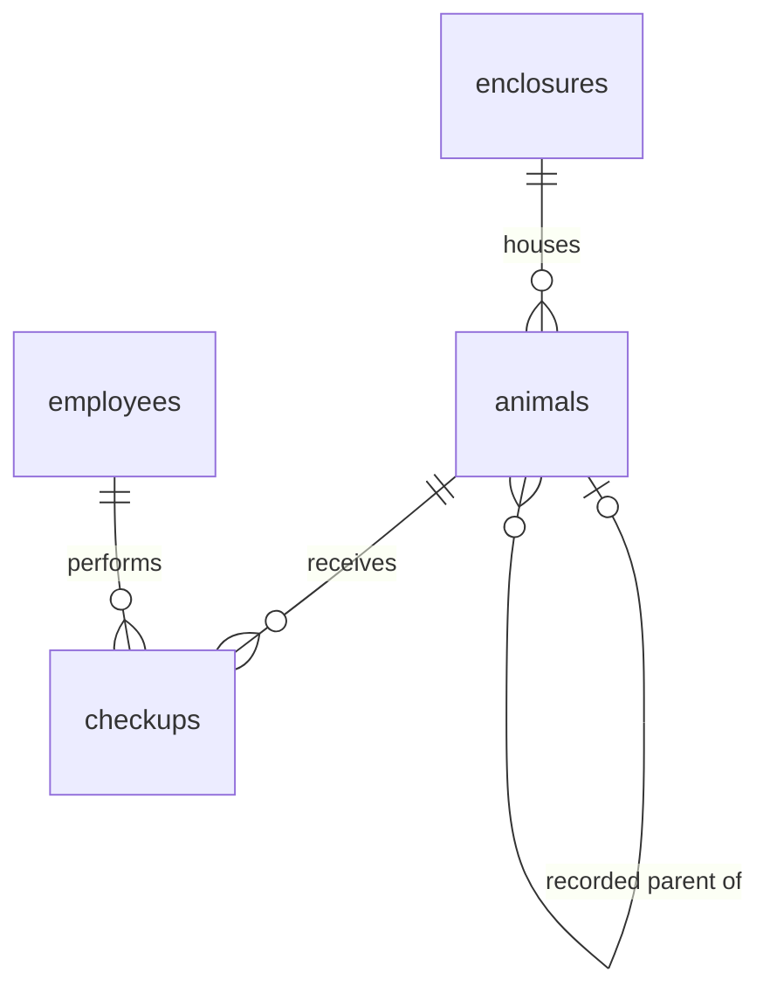

# Zoo database

A PostgreSQL 17 relational model with four tables and English names.

The planned second persistence variant is documented in
[MongoDB document structure](docs/mongodb-structure.md), including four collections,
embedded frontend views, and rules for keeping duplicated data consistent.

| Table | Fields | Purpose |
| --- | --- | --- |
| `animals` | 5 | Animal details, enclosure, and one optional recorded parent |
| `enclosures` | 4 | Enclosure details |
| `employees` | 5 | Employee details |
| `checkups` | 5 | One examination of one animal by one employee |



Each animal belongs to exactly one enclosure and has zero or one recorded parent.
One parent can have multiple offspring. This deliberately records only one parent,
as requested; it is not a complete two-parent pedigree. Each checkup references
exactly one animal and one employee. An animal or employee may have many checkups.

The model is in third normal form: fields hold single values, each table describes
one entity, and non-key attributes depend on that table's key without transitive
dependencies. Animal rows reference enclosures rather than copying their details;
checkups reference animals and employees rather than duplicating their attributes.

The required `habitat_type` uses the PostgreSQL enum `enclosure_type`:
`Savannah`, `Grassland`, `Coastal`, or `Tropical rainforest`.

The database enforces these constraints:

- Identity primary keys uniquely identify every record.
- `NOT NULL` applies to all fields except the optional `animals.parent_id`.
- `UNIQUE` applies to enclosure names and employee emails.
  Animal and employee names may repeat in real life, so they are not unique.
- `CHECK` requires positive enclosure areas, rejects empty or space-only checkup
  notes, and rejects direct self-parenting.
- The enclosure enum restricts habitats to the four listed values.
- Foreign keys require existing animals, enclosures, and employees, and prevent
  deleting referenced records while dependent records exist.

Longer ancestry cycles, biological parentage rules, and cross-table date checks
(such as a checkup occurring after birth) are outside this small model.

Requires Docker with Docker Compose. Start the database from this directory:

```sh
docker compose up -d --build --wait
```

The database is available at `localhost:5432`, database/user `zoo`, password
`zoo_local_password`. These are local development credentials. Optionally set
`POSTGRES_PASSWORD` and `POSTGRES_PORT` in a local `.env` before the first start.

Open an SQL shell or run all seven example queries:

```sh
docker compose exec db psql -U zoo -d zoo
docker compose exec -T db psql -v ON_ERROR_STOP=1 -U zoo -d zoo < queries.sql
```

`sql/01_schema.sql` creates the tables; `sql/02_seed.sql` inserts 4 enclosures,
4 employees, 8 animals, and 8 checkups. The seed script assumes a freshly created
schema. Both scripts run automatically, in filename order, on the first start.
Initialization scripts only run when the data directory is empty, as documented
by the [official PostgreSQL image](https://hub.docker.com/_/postgres).

Stop the database while preserving data:

```sh
docker compose down
```

To recreate the schema and sample data after editing the initialization scripts,
run the reset script. It rebuilds the image, removes the database volume, and
starts a fresh database. **This deletes all stored zoo data:**

```sh
./reset-db.sh
```

Without Docker, run the SQL against an existing empty PostgreSQL database:

```sh
psql -v ON_ERROR_STOP=1 -d zoo -f sql/01_schema.sql
psql -v ON_ERROR_STOP=1 -d zoo -f sql/02_seed.sql
psql -v ON_ERROR_STOP=1 -d zoo -f queries.sql
```
